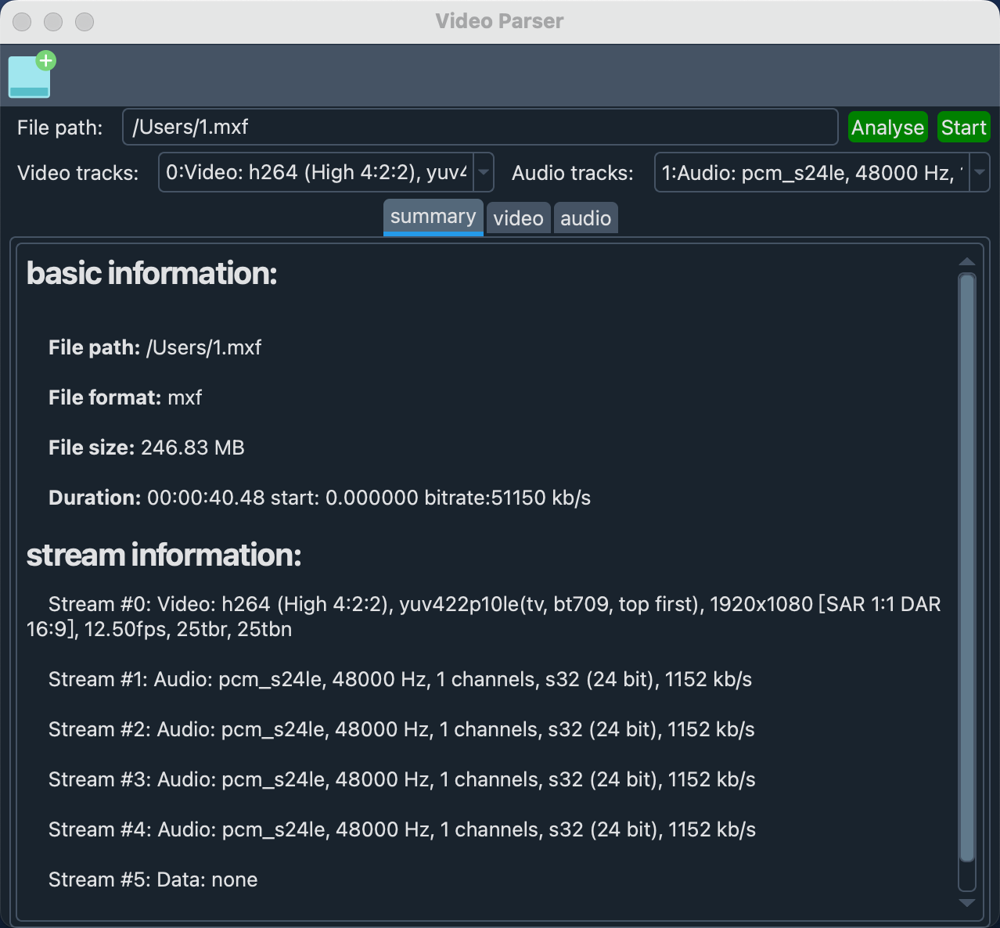
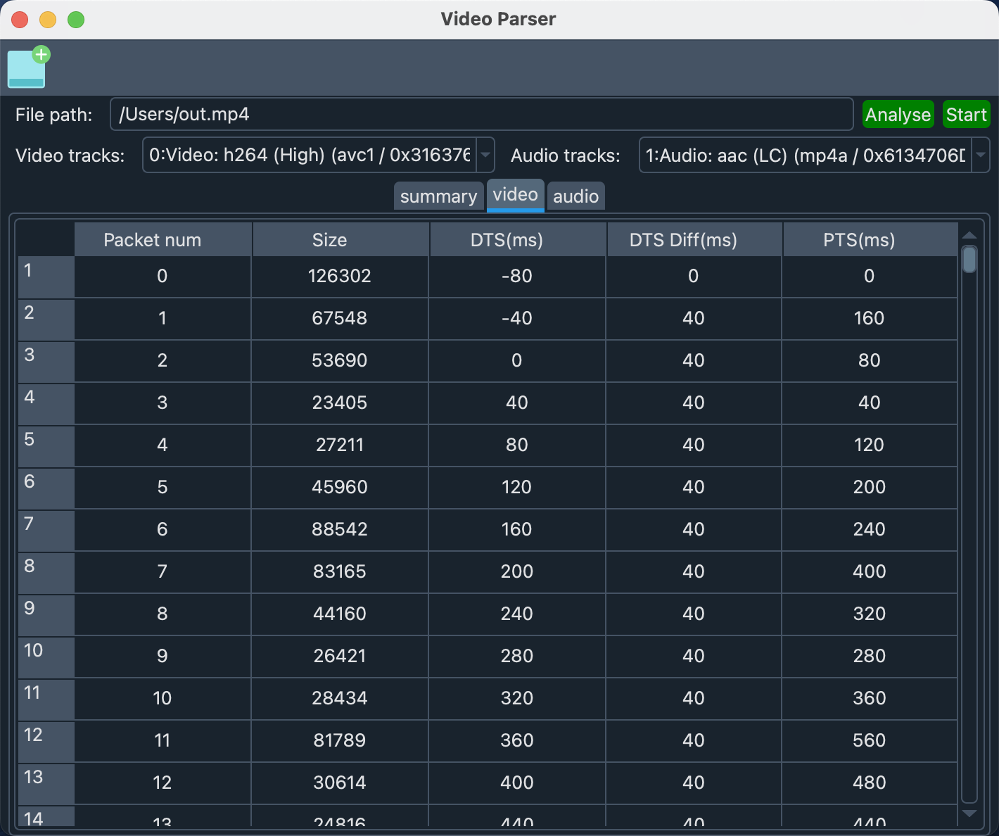
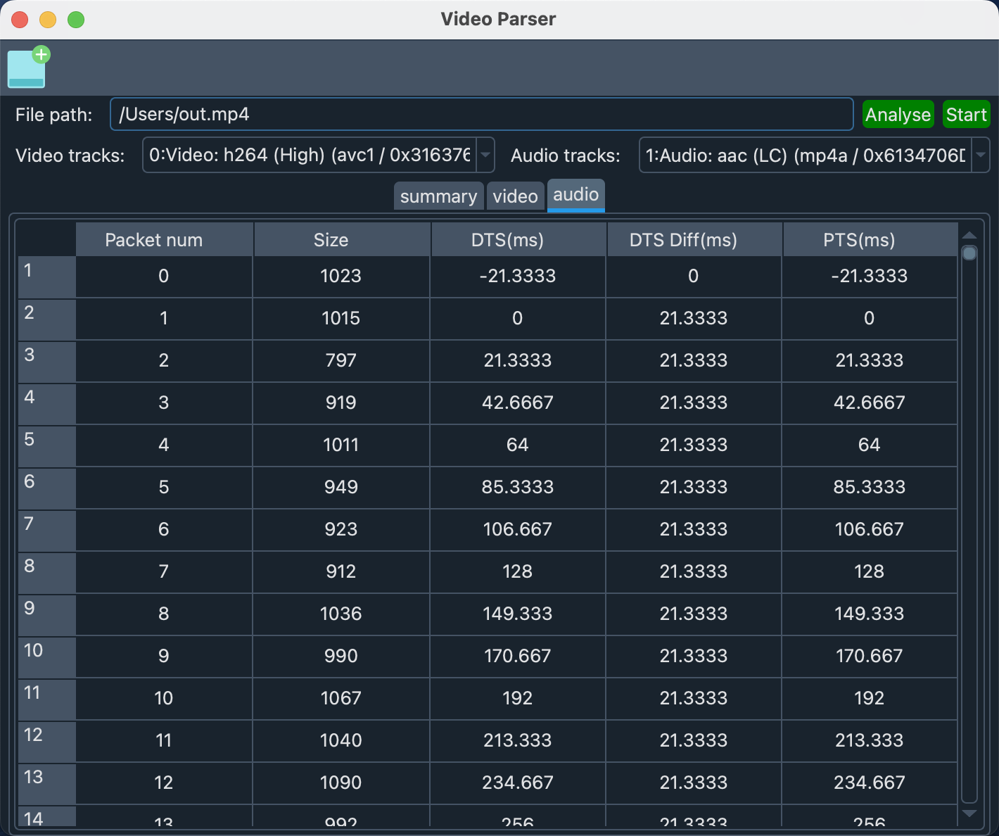
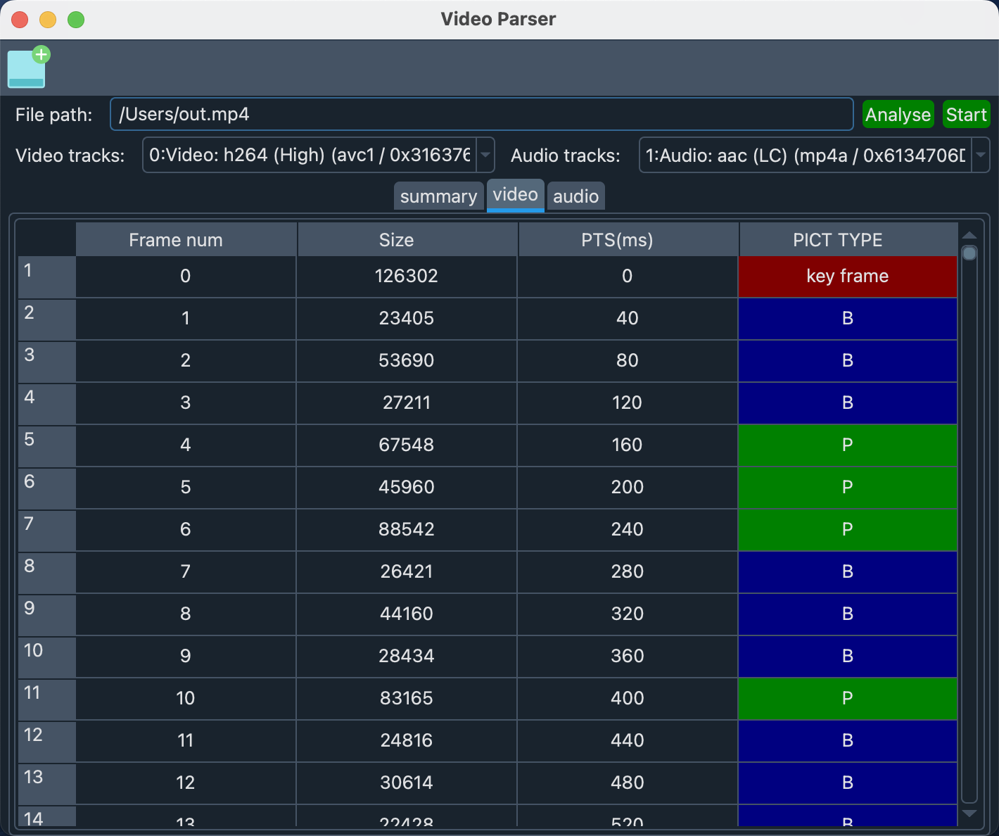
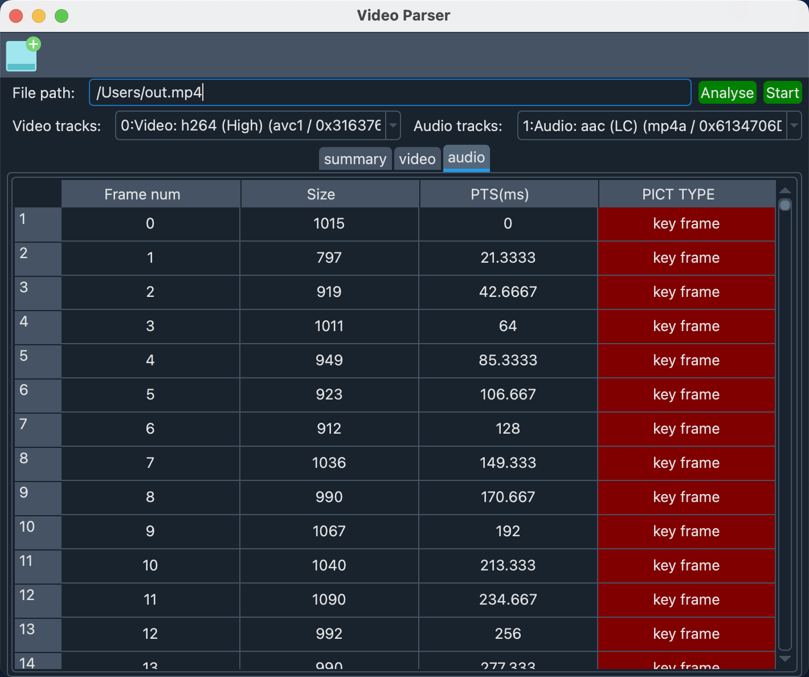

<h1 align="center">Video Parser</h1>

<p align="center">
  <b>A cross-platform GUI tool based on FFmpeg &amp; Qt that parses video/audio files and displays file, stream and timestamp information.</b>
</p>

<p align="center">
  
  
  
  
</p>

## Introduction

Video Parser opens a local video or audio file and shows you what is inside:

- **Summary** — container information (format, size, duration, start time, bitrate) and per-stream information (codec, fps, tbr, tbn, SAR/DAR, language);
- **Timestamps** — the DTS/PTS of every packet or frame, displayed in tables for the selected video and audio streams.

It is useful for learning media container/codec formats, checking timestamp (DTS/PTS) problems and inspecting GOP structure.

There are two parsing modes:

| Mode | What it reads | Video / audio table columns | Speed |
| ---- | ------------- | --------------------------- | ----- |
| **Packet mode** (default) | Container layer only, no decoding | Packet num, Size, DTS (ms), DTS diff (ms), PTS (ms) | Fast |
| **Frame mode** | Codec layer, fully decodes the file | Frame num, Size, PTS (ms), Picture type (I/P/B/...) | Slower |

## Features

- Parses both video and audio files
- Summary of basic and stream information
- Packet mode: per-packet DTS/PTS and inter-packet DTS diff
- Frame mode: per-frame PTS and picture type, with key frames highlighted
- Selectable video/audio tracks
- Progress percentage and cancel (Stop) during parsing
- Drag & drop file paths, recent files menu, remembered settings
- Dark theme and daily log files (`log/log-yyyyMMdd.txt`)
- Supports file paths containing non-ASCII characters (e.g. Chinese) on Windows

## Screenshots

Summary tab:

<p align="center">
  
</p>

Packet mode — video and audio tables:

<p align="center">
  
  
</p>

Frame mode — video and audio tables:

<p align="center">
  
  
</p>

## Usage

1. Enter a file path: type it, browse with the toolbar button or **File > Open**, or drag & drop the file onto the path box.
2. Click **Analyse** to list the video and audio tracks of the file.
3. Choose the parsing mode in **Set > Parse mode** (the choice is remembered between sessions).
4. Click **Start** to parse the file; the progress label shows the percentage, and **Stop** cancels the operation.
5. The result is shown in the **summary**, **video** and **audio** tabs. Recently parsed files appear under **File > Recent files**.

## Building

### Requirements

- Windows or macOS
- [Qt](https://www.qt.io/) 5 or 6 with Qt Creator (qmake)
- C++11 compiler: MSVC or MinGW on Windows, Clang/GCC (Xcode) on macOS
- [FFmpeg](https://ffmpeg.org/) development files (headers and `libav*` libraries)
- Git

### Configure FFmpeg paths

The FFmpeg include/library paths are hard-coded per platform in `videoparser.pro` and must be changed to match your installation:

- **macOS** (`macx` block): update `INCLUDEPATH` and `LIBS` to point to your FFmpeg installation, e.g. `/usr/local/...` (Intel Homebrew) or `/opt/homebrew/...` (Apple Silicon). If your FFmpeg is built as shared libraries, link the `.dylib` files instead of the static `.a` files.
- **Windows** (`win32` block): the repository ships prebuilt FFmpeg headers and libraries under `deps/`. Either put your FFmpeg package at the path used in the `.pro` file (`D:\QT_project\videoparser\deps\...`) or update the paths to your own installation.

Then open `videoparser.pro` in Qt Creator, select a kit and build.

## Project structure

```
videoparser/
├── include/               # headers
│   ├── ffmpegdemux.h      # packet mode (demux only)
│   ├── ffmpegdecode.h     # frame mode (decode)
│   ├── ffmpegcommon.h     # shared types and helpers
│   └── ...
├── src/
│   ├── main.cpp           # entry point, logging, dark theme
│   ├── mainwindow.cpp     # main window and result tables
│   ├── parsefile.cpp      # worker thread that runs the parsing
│   └── ...
├── ui/
│   └── mainwindow.ui      # Qt Designer form
├── deps/                  # prebuilt FFmpeg for Windows
├── qdarkstyle/            # dark/light stylesheets
├── img/                   # icons and logos
└── videoparser.pro        # qmake project file
```

## Logs

Every run writes log entries to `log/log-yyyyMMdd.txt` next to the executable.

## License

[MIT](LICENSE) © 2023 clarkh
