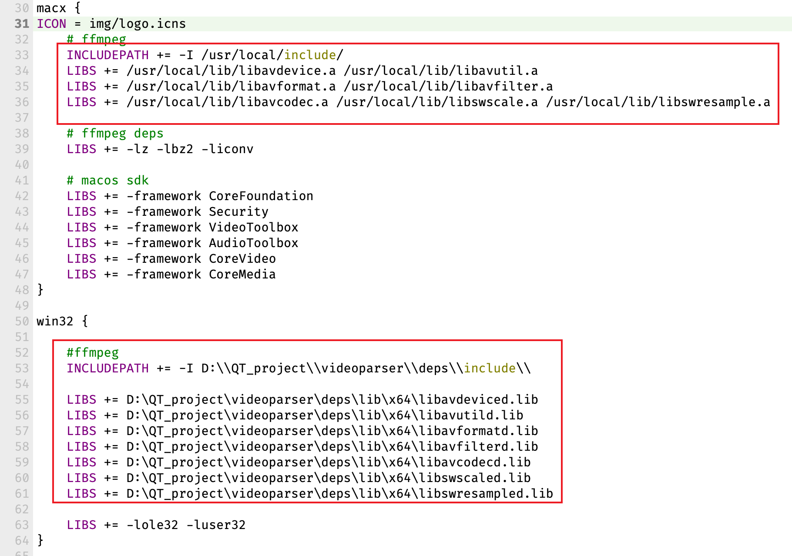

<h1 align="center">Video Parser</h1>
<h3 align="center">A cross-platform tool to parse video file and audio file then display basic informations and timestamps.</h3>

## Introduction
videoparser depends on ffmpeg and QT. It parses video file and audio files with ffmpeg api, then displays video and audio basic informations, especially displays video timestamps and audio timestamps with table forms.

videoparser has two parsing modes: packet mode and frame mode.
packet mode only parses encapsulation layer information, but frame mode will parses encode layer information, so frame mode will decode files.

summary screenshot:

packet mode screenshots:

frame mode screenshots:

## Building
#### Requirements
- Windows, macOS
- Git to clone the repository
- ffmpeg
- Qt5 or Qt6 with Qt Creator
- Build tools: MSVC, MinGW, GCC, XCode etc.

First you must replace paths about ffmpeg libs and header in pro file, as belows: 
